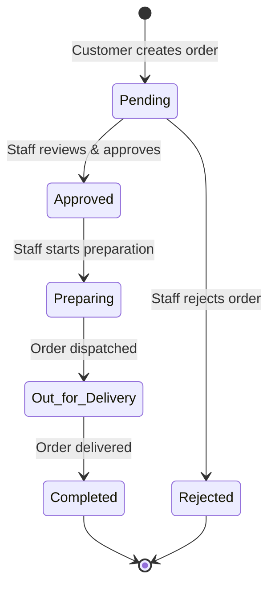

# حلويات الحلاج | Hallaj Sweets Ordering System

<div align="center">

**نظام الطلبات الإلكترونية — Backend REST API**

A secure, role-based RESTful API for an online sweets ordering platform.

Built with **Node.js · Express.js · MongoDB · Mongoose · JWT · bcrypt**

</div>

---

## Table of Contents

1. [Overview](#1-overview)
2. [Key Features & User Roles](#2-key-features--user-roles)
3. [Order Lifecycle](#3-order-lifecycle)
4. [Tech Stack & Architecture](#4-tech-stack--architecture)
5. [Installation & Setup](#5-installation--setup)
6. [Environment Variables](#6-environment-variables)
7. [API Reference & Testing Guide](#7-api-reference--testing-guide)
8. [Error Handling](#8-error-handling)
9. [License](#9-license)

---

## 1. Overview

### The Problem

Traditional sweets shops like **حلويات الحلاج** rely on in-person visits or phone calls for orders. This creates bottlenecks: customers can't browse the full catalog, staff spend time repeating product details and prices, and there's no structured way to track an order from placement to delivery. Sales data stays scattered and manual.

### The Solution

This project provides a **backend REST API** that powers a mobile application for online ordering. Customers browse a text-based product catalog (no images), place orders with flexible pricing (e.g., per kg / half-kg), and track their order through a clearly defined lifecycle. Staff manage the catalog and move orders through each stage. Admins oversee the entire operation with sales statistics and user management.

### Scope

- **Backend only** — this repository exposes a JSON REST API consumed by a separate mobile client.
- **Text-based products** — products are described by name, description, and price options. No image upload or storage.
- **Authentication** — phone + password with JWT-based session management.
- **Role-Based Access Control (RBAC)** — three distinct roles with scoped permissions.

---

## 2. Key Features & User Roles

The system implements three roles with strictly enforced access control via JWT and an `authorize` middleware layer.

### Admin

Full platform oversight and user management.

| Capability | Description |
|---|---|
| Employee management | Control staff accounts and access levels. |
| User ban / unban | Ban users with a recorded reason; banned users are blocked at login and on every authenticated request. |
| Sales statistics | Dashboard endpoint returning total orders, pending orders, completed orders, total sales revenue, customer/product/category counts. |
| Order oversight | View all orders and update any order's status. |

### Employee

Catalog and order operations.

| Capability | Description |
|---|---|
| Category management | Create, update, and delete product categories. |
| Product management | Create, update, and delete products with flexible pricing options (size + price pairs, e.g., `1kg → 25,000`, `½kg → 13,000`). |
| Order lifecycle | View all orders and advance order status through the full lifecycle (Pending → Approved → Preparing → Out for Delivery → Completed / Rejected). |

### Customer

Self-service ordering.

| Capability | Description |
|---|---|
| Secure registration & login | Phone + password authentication. Passwords are hashed with bcrypt (10 salt rounds). |
| Browse products & categories | View all products (with populated category info) and all categories — no authentication required. |
| Delivery address management | Add, list, and delete personal delivery addresses (text-based). |
| Place orders | Create orders with multiple items, each specifying product, size, and quantity. The server validates availability, looks up the price at order time, and calculates the total. |
| Track orders | View personal order history with populated product names. |

---

## 3. Order Lifecycle

Every order moves through a defined state machine. Only **Admin** and **Employee** roles can transition the status.



| State | Description | Who triggers the transition |
|---|---|---|
| `Pending` | Order placed by customer, awaiting review. | Customer (creates) → system default |
| `Approved` | Staff has reviewed and accepted the order. | Admin / Employee |
| `Preparing` | The order is being prepared in the kitchen. | Admin / Employee |
| `Out for Delivery` | Order has been dispatched to the customer. | Admin / Employee |
| `Completed` | Order successfully delivered. Terminal state. | Admin / Employee |
| `Rejected` | Order declined by staff. Terminal state. | Admin / Employee |

> **Price snapshot:** When an order is created, the unit price for each item is captured from the product's `priceOptions` at that moment and stored as `priceAtOrder`. This ensures historical orders remain accurate even if product prices change later.

---

## 4. Tech Stack & Architecture

### Technologies

| Layer | Technology | Purpose |
|---|---|---|
| Runtime | **Node.js** | JavaScript runtime |
| Framework | **Express.js 5** | HTTP routing & middleware |
| Database | **MongoDB** | NoSQL document store |
| ODM | **Mongoose 9** | Schema modeling & validation |
| Authentication | **jsonwebtoken (JWT)** | Stateless token-based auth (30-day expiry) |
| Password hashing | **bcrypt** | Secure password hashing (10 salt rounds) |
| HTTP logging | **morgan** | Request logging (dev format) |
| CORS | **cors** | Cross-origin resource sharing |
| Env config | **dotenv** | Environment variable loading |
| Dev tooling | **nodemon** | Auto-restart on file changes |

### Architecture — MVC Pattern

The project follows a clean **Model-View-Controller** pattern adapted for a REST API. Views are replaced by JSON responses. Each domain area (auth, category, product, address, order) is self-contained with its own model, controller, and route file.

```
hallaj_sweets_backend/
├── .env                      # Environment variables (not committed)
├── .env.example              # Template for environment variables
├── package.json              # Dependencies, scripts, metadata
├── src/
│   ├── server.js             # Entry point — loads env, connects DB, starts server
│   ├── app.js                # Express app — global middleware & route mounting
│   ├── config/
│   │   └── db.js             # MongoDB connection logic (Mongoose)
│   ├── models/               # Mongoose schemas (data layer)
│   │   ├── User.js           # phone, password, role, isBanned, banReason
│   │   ├── Category.js       # name, description, isActive
│   │   ├── Product.js        # name, description, category(ref), priceOptions[], isAvailable
│   │   ├── Address.js        # customer(ref), addressText
│   │   └── Order.js          # customer(ref), items[], totalAmount, shippingAddress, status
│   ├── controllers/          # Business logic (controller layer)
│   │   ├── auth.controller.js
│   │   ├── category.controller.js
│   │   ├── product.controller.js
│   │   ├── address.controller.js
│   │   └── order.controller.js
│   ├── routes/               # Route definitions + middleware chains
│   │   ├── auth.routes.js
│   │   ├── category.routes.js
│   │   ├── product.routes.js
│   │   ├── address.routes.js
│   │   └── order.routes.js
│   ├── middlewares/          # Cross-cutting concerns
│   │   ├── auth.js           # protect — verifies JWT, loads user, checks ban status
│   │   └── role.js           # authorize — RBAC role checking
│   ├── utils/                # Shared utilities
│   │   ├── hashService.js     # bcrypt hash & compare
│   │   └── jwtService.js     # JWT sign & verify
│   └── validation/           # (Reserved for request validation)
```

### Request Flow

```
HTTP Request
  → Express (app.js): cors + morgan + express.json
  → Route file: protect middleware (verify JWT → load user → check ban)
  → Route file: authorize middleware (check role against allowed roles)
  → Controller: business logic + Mongoose queries
  → JSON Response
```

---

## 5. Installation & Setup

### Prerequisites

- [Node.js](https://nodejs.org/) v18+ installed
- [MongoDB](https://www.mongodb.com/) running locally (default: `mongodb://127.0.0.1:27017`) or a MongoDB Atlas connection string
- A `.env` file configured with your environment variables (see [Section 6](#6-environment-variables))

### Steps

```bash
# 1. Clone the repository
git clone https://github.com/<your-username>/hallaj_sweets_backend.git
cd hallaj_sweets_backend

# 2. Install dependencies
npm install

# 3. Create your environment file
#    Copy the template and fill in your values
cp .env.example .env
#    On Windows PowerShell:
#    Copy-Item .env.example .env

# 4. Edit .env with your configuration (MongoDB URI, JWT secret, port)
#    Open .env in your editor and set:
#    PORT=5000
#    MONGO_URI=mongodb://127.0.0.1:27017/hallaj_sweets_db
#    JWT_SECRET=your_super_secret_key_here

# 5. Start the development server (auto-restarts on file changes)
npm run dev

#    Alternative commands:
#    npm start     → production mode (node src/server.js)
#    npm run watch → nodemon on app.js
```

Once running, you should see:

```
MongoDB Connected: 127.0.0.1
Server is running on port 5000
```

Verify the server is alive by visiting the root endpoint:

```
GET http://localhost:5000/
→ { "message": "مرحباً بك في نظام طلبات حلويات الحلاج Backend يعمل بنجاح تـام!" }
```

---

## 6. Environment Variables

Create a `.env` file in the project root. A `.env.example` template is included in the repository.

### `.env.example`

```env
# Server Port
PORT=5000

# MongoDB Connection URI
# Local: mongodb://127.0.0.1:27017/hallaj_sweets_db
# Atlas: mongodb+srv://<username>:<password>@<cluster>.mongodb.net/hallaj_sweets_db
MONGO_URI=mongodb://127.0.0.1:27017/hallaj_sweets_db

# JWT Secret Key (used for signing & verifying auth tokens)
# Generate one with: node -e "console.log(require('crypto').randomBytes(32).toString('hex'))"
JWT_SECRET=replace_this_with_a_long_random_secret_string
```

| Variable | Required | Default | Description |
|---|---|---|---|
| `PORT` | No | `5000` | Port the Express server listens on. |
| `MONGO_URI` | Yes | — | MongoDB connection string. |
| `JWT_SECRET` | Yes | `fallback_secret` | Secret key for signing/ver JWT tokens. **Must** be set in production. |

> **Security note:** The code falls back to `fallback_secret` if `JWT_SECRET` is not set. Never rely on this in production — always set a strong, random secret.

---

## 7. API Reference & Testing Guide

Base URL: `http://localhost:5000/api`

### Authentication Overview

All protected routes require a **Bearer token** in the `Authorization` header:

```
Authorization: Bearer <your_jwt_token>
```

The token is obtained from the `POST /api/auth/login` response. It encodes the user's `id` and `role`, expires in 30 days, and is verified by the `protect` middleware on every request. Banned users are rejected at this stage.

### 7.1 Authentication Endpoints

#### Register a New Customer

```http
POST /api/auth/register
```

**Access:** Public

**Request body:**

```json
{
  "phone": "07701234567",
  "password": "mySecurePassword123"
}
```

**Response — `201 Created`:**

```json
{
  "message": "تم إنشاء الحساب بنجاح",
  "userId": "65f1a2b3c4d5e6f7a8b9c0d1",
  "phone": "07701234567",
  "role": "Customer"
}
```

> Only customers can self-register. Admin and Employee accounts are created through internal management.

#### Login

```http
POST /api/auth/login
```

**Access:** Public

**Request body:**

```json
{
  "phone": "07701234567",
  "password": "mySecurePassword123"
}
```

**Response — `200 OK`:**

```json
{
  "message": "تم تسجيل الدخول بنجاح",
  "token": "eyJhbGciOiJIUzI1NiIsInR5cCI6IkpXVCJ9...",
  "role": "Customer"
}
```

**Banned user response — `403 Forbidden`:**

```json
{
  "message": "هذا الحساب محظور",
  "banReason": "Violation of platform policies"
}
```

---

### 7.2 Category Endpoints

| Method | Route | Access | Description |
|---|---|---|---|
| `GET` | `/api/categories` | Public | List all categories |
| `POST` | `/api/categories` | Admin, Employee | Create a category |
| `PUT` | `/api/categories/:id` | Admin, Employee | Update a category |
| `DELETE` | `/api/categories/:id` | Admin, Employee | Delete a category |

#### Create Category

```http
POST /api/categories
Authorization: Bearer <admin_or_employee_token>
```

**Request body:**

```json
{
  "name": "كيك",
  "description": "تشكيلة كيك المناسبات والاعياد"
}
```

**Response — `201 Created`:**

```json
{
  "message": "تم إنشاء القسم بنجاح",
  "category": {
    "name": "كيك",
    "description": "تشكيلة كيك المناسبات والاعياد",
    "isActive": true,
    "_id": "65f1a2b3c4d5e6f7a8b9c0d2",
    "createdAt": "2024-03-14T10:00:00.000Z",
    "updatedAt": "2024-03-14T10:00:00.000Z"
  }
}
```

---

### 7.3 Product Endpoints

| Method | Route | Access | Description |
|---|---|---|---|
| `GET` | `/api/products` | Public | List all products (with category populated) |
| `GET` | `/api/products/:id` | Public | Get a single product by ID |
| `POST` | `/api/products` | Admin, Employee | Create a product |
| `PUT` | `/api/products/:id` | Admin, Employee | Update a product |
| `DELETE` | `/api/products/:id` | Admin, Employee | Delete a product |

#### Create Product (with pricing options)

```http
POST /api/products
Authorization: Bearer <admin_or_employee_token>
```

**Request body:**

```json
{
  "name": "كيكة الشوكولاتة",
  "description": "كيكة بطبقات الشوكولاتة الفاخرة مع كريمة غنية",
  "category": "65f1a2b3c4d5e6f7a8b9c0d2",
  "priceOptions": [
    { "size": "1kg", "price": 25000 },
    { "size": "½kg", "price": 13000 }
  ],
  "isAvailable": true
}
```

**Response — `201 Created`:**

```json
{
  "message": "تم إضافة المنتج بنجاح",
  "product": {
    "name": "كيكة الشوكولاتة",
    "description": "كيكة بطبقات الشوكولاتة الفاخرة مع كريمة غنية",
    "category": "65f1a2b3c4d5e6f7a8b9c0d2",
    "priceOptions": [
      { "size": "1kg", "price": 25000 },
      { "size": "½kg", "price": 13000 }
    ],
    "isAvailable": true,
    "_id": "65f1a2b3c4d5e6f7a8b9c0d3",
    "createdAt": "2024-03-14T10:05:00.000Z",
    "updatedAt": "2024-03-14T10:05:00.000Z"
  }
}
```

> If the referenced `category` ID doesn't exist, the server returns `404` with `"القسم المحدد غير موجود"`.

---

### 7.4 Address Endpoints

All address routes require a **Customer** token. The `protect` + `authorize('Customer')` middleware is applied at the router level via `router.use()`.

| Method | Route | Access | Description |
|---|---|---|---|
| `GET` | `/api/addresses` | Customer | List the logged-in customer's addresses |
| `POST` | `/api/addresses` | Customer | Add a new delivery address |
| `DELETE` | `/api/addresses/:id` | Customer | Delete an address (only if owned by the customer) |

#### Create Address

```http
POST /api/addresses
Authorization: Bearer <customer_token>
```

**Request body:**

```json
{
  "addressText": "بغداد - الكرادة - شارع 62 - قرب جامع الحلاج - دار رقم 15"
}
```

**Response — `201 Created`:**

```json
{
  "message": "تم حفظ العنوان بنجاح",
  "address": {
    "customer": "65f1a2b3c4d5e6f7a8b9c0d1",
    "addressText": "بغداد - الكرادة - شارع 62 - قرب جامع الحلاج - دار رقم 15",
    "_id": "65f1a2b3c4d5e6f7a8b9c0d4",
    "createdAt": "2024-03-14T10:10:00.000Z",
    "updatedAt": "2024-03-14T10:10:00.000Z"
  }
}
```

> The `customer` field is automatically set from the authenticated user's ID — it cannot be spoofed from the request body.

---

### 7.5 Order Endpoints

| Method | Route | Access | Description |
|---|---|---|---|
| `POST` | `/api/orders` | Customer | Create a new order |
| `GET` | `/api/orders/my-orders` | Customer | List the logged-in customer's orders |
| `GET` | `/api/orders` | Admin, Employee | List all orders |
| `PATCH` | `/api/orders/:id/status` | Admin, Employee | Update an order's status |
| `GET` | `/api/orders/stats/admin` | Admin | Sales & platform statistics |

#### Create Order

```http
POST /api/orders
Authorization: Bearer <customer_token>
```

**Request body:**

```json
{
  "items": [
    {
      "productId": "65f1a2b3c4d5e6f7a8b9c0d3",
      "size": "1kg",
      "quantity": 2
    },
    {
      "productId": "65f1a2b3c4d5e6f7a8b9c0d5",
      "size": "½kg",
      "quantity": 1
    }
  ],
  "shippingAddress": "بغداد - الكرادة - شارع 62 - قرب جامع الحلاج - دار رقم 15"
}
```

**Response — `201 Created`:**

```json
{
  "message": "تم إرسال الطلب بنجاح وهو بانتظار مراجعة الموظف",
  "order": {
    "customer": "65f1a2b3c4d5e6f7a8b9c0d1",
    "items": [
      {
        "product": "65f1a2b3c4d5e6f7a8b9c0d3",
        "size": "1kg",
        "priceAtOrder": 25000,
        "quantity": 2
      },
      {
        "product": "65f1a2b3c4d5e6f7a8b9c0d5",
        "size": "½kg",
        "priceAtOrder": 13000,
        "quantity": 1
      }
    ],
    "totalAmount": 63000,
    "shippingAddress": "بغداد - الكرادة - شارع 62 - قرب جامع الحلاج - دار رقم 15",
    "status": "Pending",
    "_id": "65f1a2b3c4d5e6f7a8b9c0d6",
    "createdAt": "2024-03-14T10:15:00.000Z",
    "updatedAt": "2024-03-14T10:15:00.000Z"
  }
}
```

**Server-side validation on order creation:**

- Each `productId` must exist and have `isAvailable: true`.
- The requested `size` must match one of the product's `priceOptions`.
- `priceAtOrder` is captured from the database at order time (not from the request).
- `totalAmount` is calculated server-side as `Σ (priceAtOrder × quantity)`.

#### Update Order Status

```http
PATCH /api/orders/65f1a2b3c4d5e6f7a8b9c0d6/status
Authorization: Bearer <admin_or_employee_token>
```

**Request body:**

```json
{
  "status": "Approved"
}
```

**Valid status values:** `Pending`, `Approved`, `Preparing`, `Out for Delivery`, `Completed`, `Rejected`

**Response — `200 OK`:**

```json
{
  "message": "تم تحديث حالة الطلب بنجاح",
  "order": {
    "_id": "65f1a2b3c4d5e6f7a8b9c0d6",
    "status": "Approved",
    "customer": "65f1a2b3c4d5e6f7a8b9c0d1",
    "items": [ "... " ],
    "totalAmount": 63000,
    "shippingAddress": "بغداد - الكرادة - شارع 62 - قرب جامع الحلاج - دار رقم 15"
  }
}
```

#### Admin Statistics

```http
GET /api/orders/stats/admin
Authorization: Bearer <admin_token>
```

**Response — `200 OK`:**

```json
{
  "totalOrders": 150,
  "pendingOrders": 12,
  "completedOrdersCount": 120,
  "totalSales": 3450000,
  "totalCustomers": 87,
  "totalProducts": 34,
  "totalCategories": 8
}
```

---

### 7.6 Testing with Postman

1. **Create a new Postman environment** with a variable `baseUrl` set to `http://localhost:5000/api` and a variable `token` (initially empty).

2. **Register or log in** using `POST {{baseUrl}}/auth/login`. In the **Tests** tab, add this script to auto-save the token:

   ```javascript
   const res = pm.response.json();
   if (res.token) {
       pm.environment.set("token", res.token);
       pm.environment.set("role", res.role);
   }
   ```

3. **For all protected requests**, add the Authorization header:

   ```
   Authorization: Bearer {{token}}
   ```

4. **Role testing:** Create three users with different roles (Admin, Employee, Customer) by seeding them directly in MongoDB, then log in with each to test that RBAC correctly allows or blocks access to endpoints.

---

## 8. Error Handling

All errors return JSON with a `message` field (in Arabic) and, where applicable, an `error` field with the technical detail.

| HTTP Status | Meaning | Example Message |
|---|---|---|
| `200` | Success | `تم تحديث حالة الطلب بنجاح` |
| `201` | Created | `تم إنشاء الحساب بنجاح` |
| `400` | Bad request / validation | `رقم الهاتف مستخدم مسبقاً` |
| `401` | Not authenticated / invalid token | `غير مصرح، الرمز غير صالح` |
| `403` | Forbidden (wrong role or banned) | `ليس لديك الصلاحية للقيام بهذه العملية` |
| `404` | Resource not found | `المنتج غير موجود` |
| `500` | Server error | `خطأ في الخادم` |

---

## 9. License

This project is licensed under the **ISC License** — see the `package.json` for details.

---

<div align="center">

**حلويات الحلاج — Hallaj Sweets Ordering System**

Developed as a backend REST API for the Hallaj Sweets mobile ordering platform.

</div>
